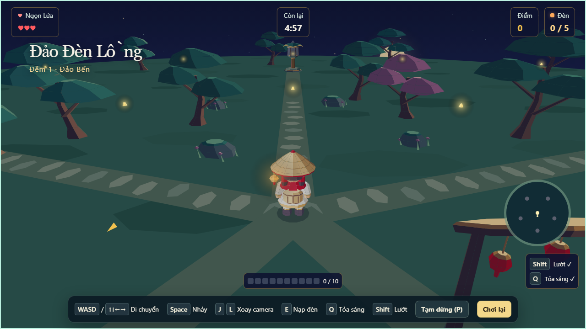

# Đảo Đèn Lồng · Ba Đêm (v1.0.0)

[Xem video demo MP4](https://github.com/Teddyy1101/K5-L3A-DAY12-NguyenHuyThu-2A202603356-AI-SDLC-Dao-Den-Long/releases/download/v1.0.0/dao-den-long-demo.mp4) · [Tải bản game v1.0.0](https://github.com/Teddyy1101/K5-L3A-DAY12-NguyenHuyThu-2A202603356-AI-SDLC-Dao-Den-Long/releases/tag/v1.0.0)

Mây gom đom đóm để thắp và châm dầu cho đèn qua ba Đêm. Tới bình minh, Mây phải còn sống và giữ đủ đèn sáng.



## Yêu cầu hệ thống

- Node.js 22 trở lên (không cần `npm install`, không có gói ngoài).
- Trình duyệt hỗ trợ Canvas 2D (Chrome, Edge, Firefox, Safari). Bench cần Chrome hoặc Edge, hoặc đặt `CHROME_PATH`.
- Windows, macOS hoặc Linux.

## Cài đặt và chơi

```sh
git clone https://github.com/Teddyy1101/K5-L3A-DAY12-NguyenHuyThu-2A202603356-AI-SDLC-Dao-Den-Long.git
cd K5-L3A-DAY12-NguyenHuyThu-2A202603356-AI-SDLC-Dao-Den-Long
node src/server.mjs
```

Mở `http://127.0.0.1:3000`. Đổi cổng bằng biến môi trường `GAME_PORT`. Nếu dùng gói ZIP từ Release v1.0.0, giải nén, mở terminal trong thư mục game rồi chạy `node src/server.mjs`.

## Điều khiển

Mặc định như bảng sau. Mở **Cài đặt → Đổi phím** để đổi mọi hành động. Phím trùng bị từ chối kèm thông báo, có nút **Khôi phục mặc định**, cấu hình được lưu.

| Phím | Hành động |
|---|---|
| `W A S D` hoặc phím mũi tên | Di chuyển theo camera |
| `Space` | Nhảy |
| `J` / `L` hoặc kéo chuột | Xoay camera |
| `Shift` | Lướt |
| `E` | Nạp đom đóm vào đèn gần nhất. Thắp lần đầu cần 10, thắp lại cần 5, mỗi đom đóm châm 10 dầu |
| `Q` | Tỏa Sáng (3 đom đóm): đẩy lùi, làm choáng Bóng Mực, xua Gió Lạc |
| `1` | Mộc Độn, hồi chiêu 5 giây |
| `2` | Mưa sao băng (hồi 8 giây), hiệu ứng hình ảnh, không đổi luật. Mở **Cài đặt → Mưa sao băng · hiệu ứng** để bật/tắt và chỉnh từng bước: đầu sáng, vệt đuôi, nổ tia, sao văng, mưa liên tục, bonus ô và sao băng khổng lồ |
| `3` | Phép băng (hồi 6 giây), hiệu ứng hình ảnh: hàng gai băng mọc từ đất tới quái, đất nứt, gai tan thành mảnh, rồi khối băng bọc quái. Chỉnh từng hiệu ứng ở **Cài đặt → Phép băng · hiệu ứng** |
| `Esc` / `P` | Tạm dừng. Đổi tab cũng tự tạm dừng |

Đêm 1/2/3 dài **240/270/300 giây**, cần giữ **3/4/5 đèn** sáng. Đèn hao 1 dầu mỗi giây; dưới 30 dầu đèn mất vùng an toàn 6 m. Điểm: +5 mỗi đom đóm, thắp lần đầu +100, thắp lại +40, Tỏa Sáng trúng +5 (+15 nếu đang hút dầu), thưởng bình minh 50 mỗi đèn cộng phần nguyên dầu và 50 mỗi Ngọn Lửa.

### Bảng xếp hạng

Sau bình minh Đêm 3 hoặc sau khi thua ở bất kỳ Đêm nào, nhập tên 3–12 ký tự `[A-Za-z0-9_]`. Giữ top 10 theo điểm giảm dần, bằng điểm thì người đạt trước đứng trên. Dữ liệu lưu ở `~/.dao-den-long/leaderboard.json` (đổi bằng `GAME_DATA_DIR`). Xem từ **Bảng xếp hạng** ở menu chính. Xuất: `node src/server.mjs --export-leaderboard out.json`.

### Dễ tiếp cận

- Đổi phím toàn bộ hành động, có phát hiện trùng.
- Phụ đề và chỉ báo: Bóng Mực xuất hiện (kèm mũi tên ở mép màn hình), gió sắp thổi, 10 giây cuối, đèn dưới 30 dầu.
- **Giảm chuyển động**: tắt rung camera và chớp màn hình (mặc định theo `prefers-reduced-motion`).
- Cỡ chữ UI tối thiểu 18 px; tùy chọn **Chữ lớn (×1.25)**. Có **Bảng màu dễ phân biệt**.

## Headless, kiểm thử, benchmark, soak

Cấu hình Contract 1.3 ở [game.contract.json](game.contract.json).

```sh
node --test                                                    # toàn bộ test
node src/headless.mjs --seed 1201 --night 1 --scenario docs/proof/phase-3/lanterns.scenario.json --inputs docs/proof/phase-3/lanterns.inputs.json --ticks 120 --out lanterns.jsonl
node src/bench.mjs --seed 42 --duration 30 --out bench.json    # cần Chrome/Edge, mở cửa sổ 1280x720
node --expose-gc src/soak.mjs --seed 7 --nights 10 --out soak.json
```

**Bench**: cảnh chuẩn 200 Bóng Mực wander, 100 đom đóm, 3 đèn sáng fuel 100, camera bay vòng bán kính 30 m, cao 15 m, 15 s một vòng; 3 s đầu khởi động. Render là Canvas 2D, trình duyệt không cho tắt vsync từ trang web nên `vsync_off` là `false` và FPS bị chặn ở tần số quét màn hình. Bản web không đọc được RSS của tiến trình trình duyệt từ trang, nên `peak_mem_mb` là `null`. Biến `BENCH_HEADLESS=1` chạy Chrome ẩn, `BENCH_SOFTWARE=1` tắt GPU.

**Soak**: một Đêm chạy khởi động bỏ đi để ổn định JIT, sau đó đo RSS (có `gc()`) sau khi tải Đêm đầu và sau Đêm cuối. Heap giữ phẳng ở khoảng 3.7 MB, RSS chỉ dao động do bộ cấp phát.

Kết quả tự đo: [bench.json](bench.json), [soak.json](soak.json). Bằng chứng: [Phase 1 và bản khôi phục Contract 1.0](docs/proof/phase-1/README.md), [Phase 2](docs/proof/phase-2/README.md), [Phase 3](docs/proof/phase-3/README.md), [Phase 4](docs/proof/phase-4/README.md). Lịch sử: [CHANGELOG](CHANGELOG.md). Nguồn asset: [CREDITS](CREDITS.md). Giấy phép: [LICENSE](LICENSE). Retro: [docs/retro.md](docs/retro.md).
## Sáng tạo của tôi

Bản đồ nhỏ chỉ vị trí Mây, hướng camera và các Đèn Lồng Lớn. Mỗi đèn đã thắp tạo một quầng sáng vàng cam, hắt lên Mây và cây đá ở gần. Ánh sáng giảm dần trong phạm vi 8 m. Bóng Mực có áo choàng rủ thành dải mực và đôi mắt chuyển vàng khi bị choáng. Bài kiểm thử Canvas và kiểm tra tính tất định của JSONL nằm trong [bộ kiểm thử Phase 1](test/).

## Tài liệu lab Day 12

> **Cá nhân** (1 người / 1 MSSV) · Áp dụng SDLC cùng AI để xây một **game 3D** qua **4 phase**, từ yêu cầu ban đầu tới bản phát hành.
> **Lab board + trợ giảng:** **[Đảo Đèn Lồng Lab](https://claude.ai/artifact/Q1RYyv1dxjUczzCbd2ZnoW)**

---

## Tài liệu của lab

| File | Nội dung |
|---|---|
| [GUIDE.md](GUIDE.md) | Hướng dẫn làm lab: vòng làm việc mỗi phase, harness, kiểm chứng, token |
| [CHECKPOINTS.md](CHECKPOINTS.md) | Các mốc tự kiểm tra từ chuẩn bị đến nộp bài |
| [SUBMISSION.md](SUBMISSION.md) | Đặt tên repo, hạn nộp, tag, Release, video, checklist |
| [RULES.md](RULES.md) | Quy định: AI, trung thực về bằng chứng, bản quyền, bảo mật |
| [RUBRIC.md](RUBRIC.md) | Thang điểm chi tiết |

## Lab board

Yêu cầu dự án được phát hành tại **[Đảo Đèn Lồng Lab](https://claude.ai/artifact/Q1RYyv1dxjUczzCbd2ZnoW)**. Mỗi phase là một tab (tab chưa phát hành bị khóa), mỗi tab có trợ giảng AI riêng chỉ trả lời trong phạm vi phase đó. Trợ giảng cần đăng nhập claude.ai và dùng lượt Claude của bạn.

## Dự án

**Đảo Đèn Lồng**: game 3D góc nhìn thứ ba. Mây, người giữ đèn nhỏ tuổi, gom đom đóm để thắp lại các Đèn Lồng Lớn và né Bóng Mực trong sương đen.

- Không ràng buộc công nghệ; chạy được trên macOS hoặc Linux.
- Tuân theo **Test Contract** (chế độ headless) để được chấm tự động và so sánh với nhau.

| Phase | Bạn nhận | Nộp |
|---|---|---|
| 1 | **PRD-0** (mô tả tổng quát) + Test Contract | tag `phase-1` |
| 2 | **Ticket-02**, phát hành khi Phase 1 kết thúc | tag `phase-2` |
| 3 | **Ticket-03**, phát hành khi Phase 2 kết thúc | tag `phase-3` |
| 4 | **Ticket-04**, phát hành khi Phase 3 kết thúc | tag `phase-4` + Release `v1.0.0` |

Yêu cầu sẽ được bổ sung và có thể thay đổi giữa các phase, giống dự án thật.

### Lịch 4 giờ

Bài lab kéo dài **4 giờ**. Phase 1 và 2 khoảng **1 giờ**, Phase 3 khoảng **30 phút**, Phase 4 khoảng **1 giờ 30 phút**. Mỗi phase phát hành đúng mốc giờ. Phase mới xuất hiện trên lab board khi tới mốc.

| Mốc | Sự kiện | Hạn tag |
|---|---|---|
| 0h | Phát hành **Phase 1** (PRD-0), gồm cả phần chuẩn bị | `phase-1` trước mốc 1h |
| 1h | Phát hành **Phase 2** | `phase-2` trước mốc 2h |
| 2h | Phát hành **Phase 3** | `phase-3` trước mốc 2h30 |
| 2h30 | Phát hành **Phase 4** | `phase-4`, Release `v1.0.0` và video trước mốc 4h |
| 4h | Hết giờ lab, chốt bài | |

Hết giờ mỗi phase thì tag và chuyển sang phase tiếp theo, dù phase chưa hoàn hảo. Chỗ chưa xong ghi trung thực trong bằng chứng.

---

## Gợi ý SDLC (cách làm là của bạn)

Mỗi phase là một vòng nhỏ. Công cụ, thứ tự, định dạng tài liệu đều tự do; đây chỉ là gợi ý:

1. **Requirements:** biến yêu cầu thành tiêu chí nghiệm thu kiểm chứng được. Chỗ mơ hồ thì tự giả định và ghi lại.
2. **Plan:** nghĩ cách kiểm chứng **trước** khi để agent viết code.
3. **Build:** để agent viết, bạn điều phối và review.
4. **Verify:** chạy thật, kiểm tra hành vi thật. *Không có bằng chứng thì chưa xong*: "agent bảo chạy rồi" không phải bằng chứng.
5. **Evaluate:** cái gì đạt, AI sai ở đâu, harness (AGENTS.md, skill, hook) cần chỉnh gì.
6. **Release:** gắn tag.

## Ba điều cần nhớ

> Bạn được **tự do sáng tạo thêm** quanh phần lõi (nhân vật, cơ chế nhỏ, câu chuyện, hiệu ứng, âm thanh…). Sáng tạo gọn và không phá yêu cầu được tính điểm trong hạng mục F của [RUBRIC](RUBRIC.md); ghi mục "Sáng tạo của tôi" trong README của bạn.

- **Game tốt là game đúng yêu cầu của khách hàng**, không phải game phức tạp hay đẹp nhất. Làm đúng và chứng minh được là đúng trước, trau chuốt sau.
- **Cân nhắc kỹ quota token của bạn.** Đốt nhiều token không làm bài tốt hơn. Ngữ cảnh gọn, kế hoạch rõ, kiểm chứng sớm thường vừa rẻ vừa đúng hơn chạy agent liên tục.
- **Kiểm chứng là phần quan trọng nhất.** Bằng chứng (test, output headless, ảnh, số đo) đáng giá hơn lời mô tả.

---

## Bàn giao cuối cùng

Một **repo GitHub cá nhân, public**, gồm:

1. **Toàn bộ mã nguồn** của game qua 4 phase, tag `phase-1` … `phase-4`, Release `v1.0.0`.
2. **Video demo `.mp4` dưới 5 phút** (đính kèm Release `v1.0.0` hoặc `docs/demo/demo.mp4`, link ở đầu README): chơi thử và cho thấy bằng chứng game chạy đúng.
3. **Bằng chứng kiểm chứng** của từng phase (định dạng tự chọn).
4. **Harness AI đã dùng** (AGENTS.md / CLAUDE.md, skills, hooks, plugins…), giữ nguyên trong repo và lịch sử git.
5. **Ghi chép ngắn:** spec/giả định mỗi phase, nhật ký dùng AI (gồm token/chi phí ước tính), retro.

Không commit API key, token hay `.env`. Gửi link repo theo hướng dẫn của Coach.

## Đánh giá (100 điểm)

| Hạng mục | Điểm |
|---|---|
| Test tự động ẩn (headless, gồm kiểm tra lại phase trước) | 30 |
| Kiểm chứng & bằng chứng của bạn | 20 |
| Quy trình SDLC & harness AI | 15 |
| Evaluation & retro (gồm cách bạn dùng token) | 10 |
| Hiệu năng & ổn định | 10 |
| Chất lượng sản phẩm (đúng yêu cầu, chơi được) | 10 |
| Video demo | 5 |

## Quy định

- Dùng AI thoải mái; không sao chép repo của người khác.
- Bằng chứng phải thật: test luôn đạt hay output sửa tay là vi phạm.
- Nhân vật, bối cảnh là bản gốc của lab; asset bên ngoài chỉ dùng loại CC0/CC-BY/MIT hoặc tự tạo, ghi nguồn trong `CREDITS.md`.
